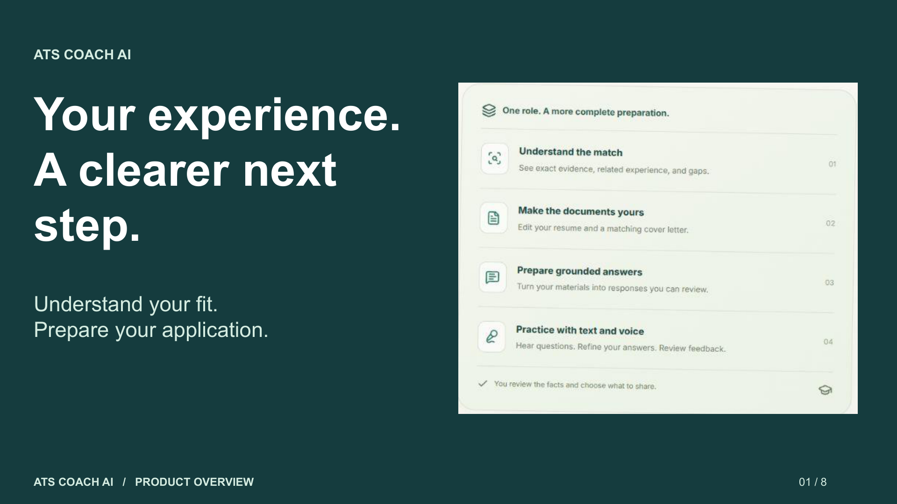

# ATS Coach AI

[Open the app](https://remix-remix-ats-coach-ai-1403.ai.studio/)

An educational application preparation workspace for job seekers, career coaches, university programs, and product demonstrations. Compare a resume with a target role, review the evidence, edit documents, prepare application answers, and practice interviews with text and voice.



## Getting started

Choose **Explore the interactive sample** for a prepared example without waiting for AI. Sample diagnosis, answers, and practice feedback stay clearly labelled. For personalized output, add your own materials and run live analysis.

The welcome screen's **Watch the overview** and the workspace's **How to use** controls open separate narrated videos and slide decks. Each has English captions, a transcript, PowerPoint and PDF downloads, and a thank-you ending.

| Media | Slides | Video |
| --- | ---: | --- |
| Product introduction for users and clients | 8 | [1:43 overview](public/overview/ats-coach-overview.mp4) |
| Complete app walkthrough | 13 | [3:17 walkthrough](public/guide/ats-coach-walkthrough.mp4) |

## Application tools

- Match diagnosis separates exact evidence, related experience, and unsupported requirements.
- Resume and cover-letter canvases support direct editing, fonts, spacing, and margins, with PDF review and download.
- Application Q&A supports spoken questions, dictation, answer transcripts, evidence review, and answer downloads.
- Interview practice offers question playback, speaking pace, answer transcription, feedback, follow-up questions, and downloadable notes.
- Named workspace JSON downloads preserve inputs, the original baseline, diagnosis, reviewed documents, formatting, and checklist. Open a saved file to restore those materials. Download application answers and interview notes separately.
- The preparation checklist tracks facts, final PDF formatting, and approved downloads. Its completion count describes preparation steps.

## Interface and reliability improvements

The redesign adds a guided welcome screen, instant labelled sample, clearer progress navigation, persistent help access, saved workspaces with validated imports, document review checklist, preparation notes, retained drafts when switching workspace tabs, answer exports, interview note exports, question speaking pace, pending-audio status and recovery, cancellation of longer analysis requests, input-change warnings, and accessible replacement dialogs.

The heavier PDF tools load when the document workspace opens. In the production build, the main JavaScript bundle decreased from approximately 2,711 kB to 813 kB before gzip. Source evidence and factual preservation rules remain in place.

## Voice setup

Open the published app directly in Chrome. Allow the site's microphone through the address-bar site controls. Windows also needs microphone access enabled for desktop apps under **Settings > Privacy & security > Microphone**. Save the workspace before reloading. Speech playback and recognition depend on the browser, device, and its permissions. Typed input remains available.

Recorded speech becomes an editable transcript. The user reviews the text before submitting it for AI feedback. This release verifies the controls and error handling without recording ambient user audio.

## Running locally

Use Node.js 20 or later. Install dependencies with `npm install`, configure the server environment using `.env.example`, then run `npm run dev`. Personal API keys stay outside saved workspace files.

Validation commands:

```text
npm run lint
npm run test:latex
npx tsx --test src/utils/workspace.test.ts src/utils/speechPlayback.test.ts
npm run build
```

Educational scores do not predict employer decisions or guarantee employment. Review all facts and exported documents before sharing. The privacy guidance in the app explains AI and browser speech processing.
